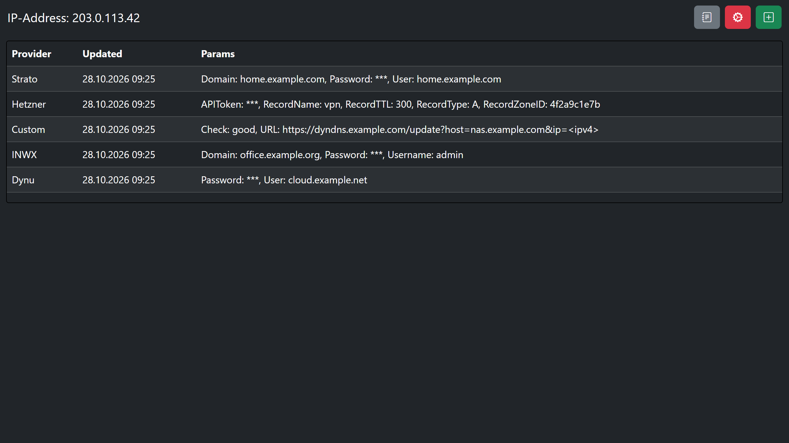
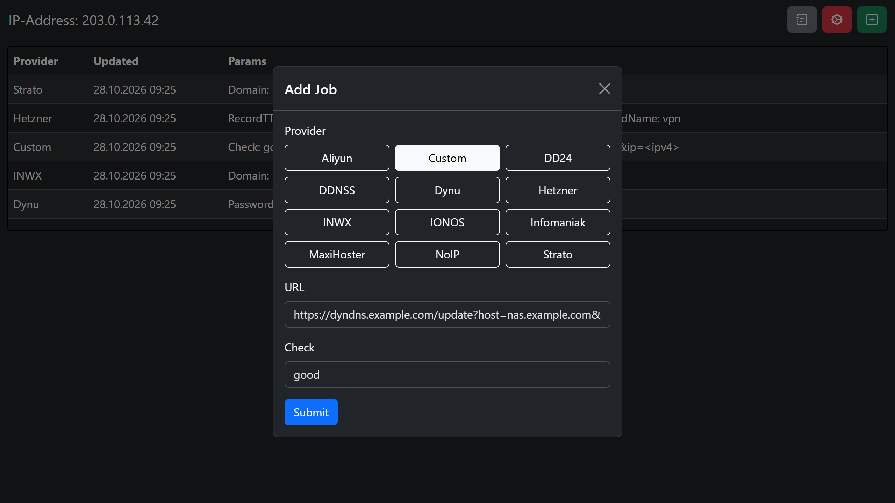
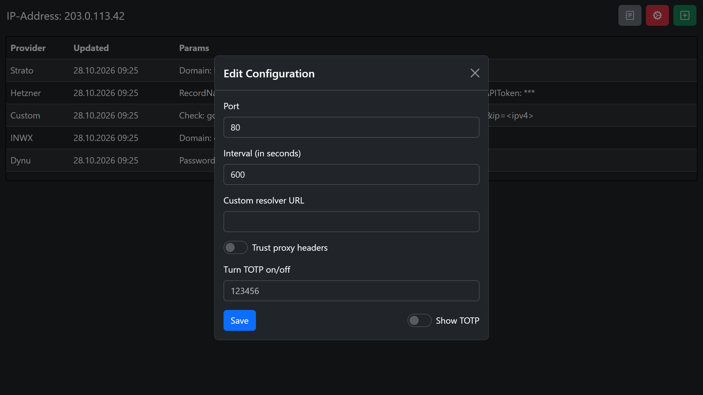
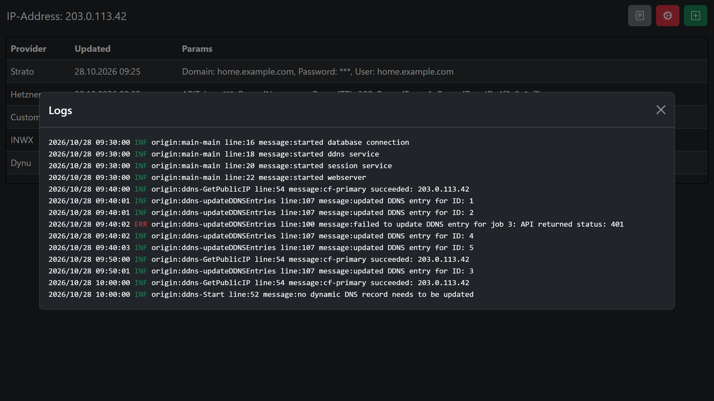
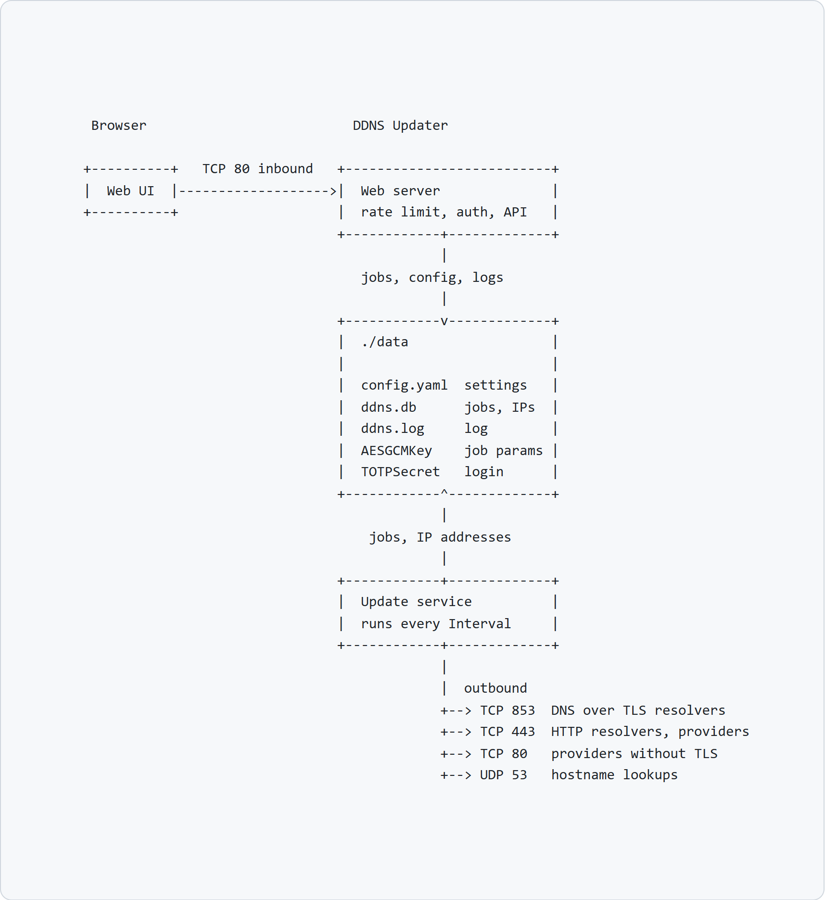
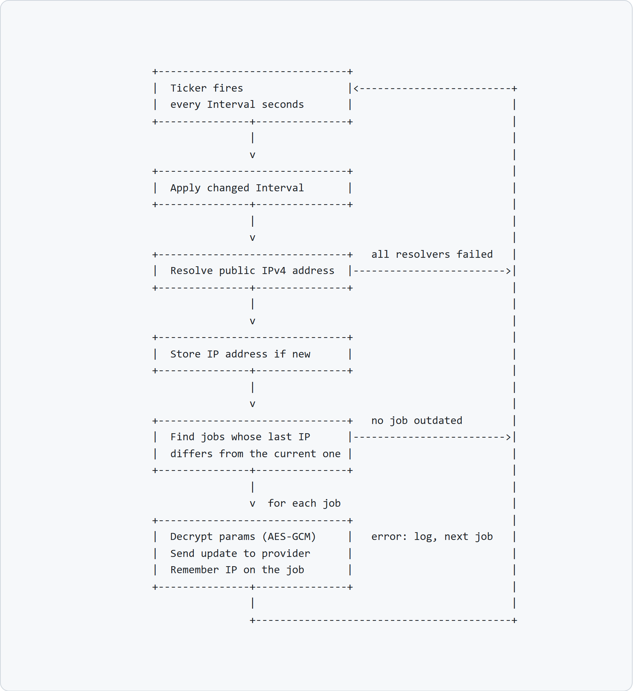
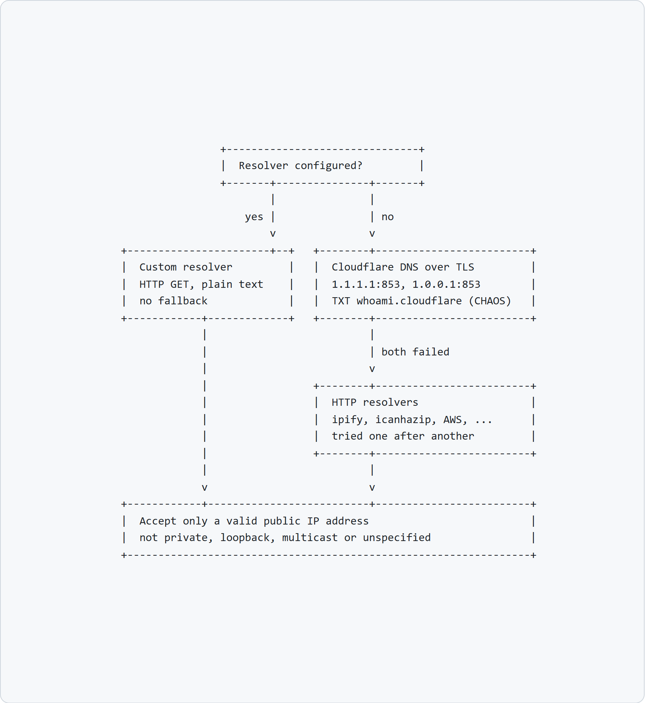
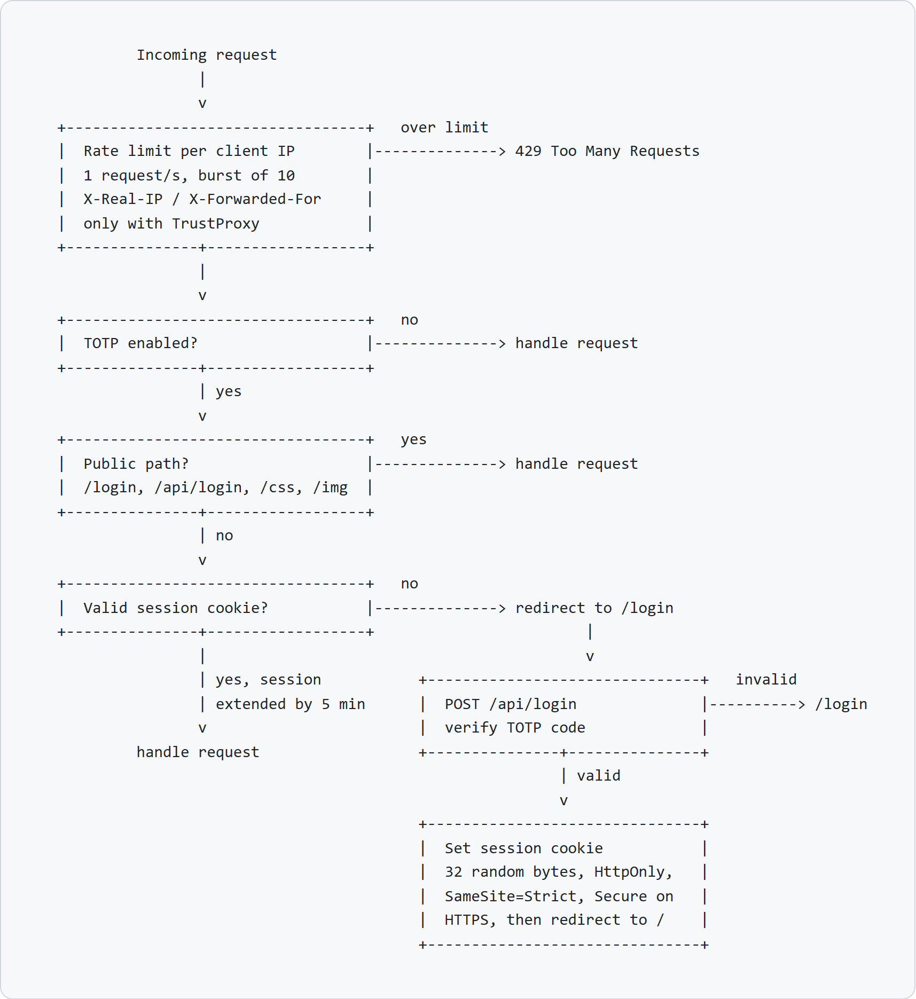

# DDNS Updater

> This project was built before AI was a thing for me. Today it helps with troubleshooting and dependency updates. Whether that is a mark of quality or the opposite is up to you.

[](https://opensource.org/licenses/BSD-3-Clause)
[](https://calver.org/)
[](https://github.com/plaenkler/ddns-updater/actions/workflows/linters.yml)
[](https://github.com/plaenkler/ddns-updater)
[](https://www.buymeacoffee.com/Plaenkler)

DDNS Updater keeps your dynamic DNS records in sync with your public IPv4 address.
Update jobs and settings are managed in a web interface, so there is no need to edit files or work on the command line.

<table>
  <tr>
    <td></td>
    <td></td>
  </tr>
  <tr>
    <td></td>
    <td></td>
  </tr>
</table>

## Features

- Web interface for jobs, settings and logs
- Optional TOTP login and encrypted job parameters
- Updates only when the IP address has changed
- Runs as Docker container, standalone application or Windows service

## Supported providers

`Aliyun` `DD24` `DDNSS` `Dynu` `Hetzner` `INWX` `Infomaniak` `IONOS` `MaxiHoster` `NoIP` `Strato`

> If your provider is missing, open an issue and it will be added.

### Custom provider

Every provider that offers an update URL can be used with the provider **Custom**:

1. Enter the update URL in the **URL** field and put the placeholder `<ipv4>` where the IP address belongs.
2. Enter a text in the **Check** field that the provider's response contains when the update was successful.

## Installation

### Docker

[Compose](https://docs.docker.com/compose/) is the most convenient way to run DDNS Updater.
All data is stored in `/app/data`, so mount it as a volume to keep it across updates.

**Bridge network**

```yaml
---

services:
  ddns:
    image: plaenkler/ddns-updater:latest
    container_name: ddns
    restart: always
    networks:
      - web
    ports:
      - 80:80
    volumes:
      - ./ddns:/app/data
    environment:
      - DDNS_INTERVAL=600
      - DDNS_TOTP=false
      - DDNS_PORT=80

networks:
  web:
    external: false
```

**Macvlan network**

```yaml
---

services:
  ddns:
    image: plaenkler/ddns-updater:latest
    container_name: ddns
    restart: always
    networks:
      web:
        ipv4_address: 10.10.10.2
    volumes:
      - ./ddns:/app/data
    environment:
      - DDNS_INTERVAL=600
      - DDNS_TOTP=false
      - DDNS_PORT=80

networks:
  web:
    name: web
    driver: macvlan
    driver_opts:
      parent: eth0
    ipam:
      config:
        - subnet: "10.10.10.0/24"
          ip_range: "10.10.10.0/24"
          gateway: "10.10.10.1"
```

**Reverse proxy**

DDNS Updater can run behind a reverse proxy like [Traefik](https://doc.traefik.io/traefik/) or [NGINX](https://nginx.org/).
Enable `TrustProxy` so that the client IP address is taken from the `X-Real-IP` or `X-Forwarded-For` header.
Only do this if DDNS Updater is reachable exclusively through the proxy, otherwise clients can spoof their IP address.

### Build from source

Building requires [Go](https://go.dev/dl/) 1.27 or newer, a C compiler is not needed.
Clone the repository and run the following commands from its root.

**Standalone application**

```text
go build -o ddns-updater cmd/def/main.go
```

**Windows service**

```text
go build -o ddns-updater.exe cmd/svc/main.go
```

Copy the executable to a folder of your choice and register it as a service:

```text
sc create DDNS-Updater binPath=[INSTALL_DIR]\ddns-updater.exe type=share start=auto DisplayName=DDNS-Updater
```

### Data directory

All state is kept in the folder `data` next to the working directory:

| File          | Content                                |
| ------------- | -------------------------------------- |
| `config.yaml` | Settings                               |
| `ddns.db`     | Update jobs and known IP addresses     |
| `ddns.log`    | Log                                    |
| `AESGCMKey`   | Key that encrypts the job parameters   |
| `TOTPSecret`  | Secret for the TOTP login              |

Back up the whole folder.
Without `AESGCMKey` the stored jobs can no longer be decrypted.

## Configuration

There are three ways to configure DDNS Updater:

1. **Web interface:** Open `http://host-ip` and click the gear icon. Changes are written to `config.yaml`. A new port requires a restart, all other settings take effect without one.
2. **Configuration file:** Edit `data/config.yaml`. It is created with default values on first start, and changes apply after a restart.
3. **Environment variables:** They are read on start and take precedence over the configuration file.

| Setting    | Environment variable | Default | Description                                                          |
| ---------- | -------------------- | ------- | -------------------------------------------------------------------- |
| Interval   | `DDNS_INTERVAL`      | `600`   | Seconds between two checks of the IP address                         |
| TOTP       | `DDNS_TOTP`          | `false` | Require a TOTP login for the web interface                           |
| Port       | `DDNS_PORT`          | `80`    | Port of the web interface                                            |
| Resolver   | `DDNS_RESOLVER`      | empty   | URL of a custom resolver that returns the IPv4 address in plain text |
| TrustProxy | `DDNS_TRUST_PROXY`   | `false` | Take the client IP address from headers set by a reverse proxy       |

The default `config.yaml` looks like this:

```yaml
Interval: 600
TOTP: false
Port: 80
Resolver: ""
TrustProxy: false
```

### Enable TOTP

1. Open the settings and turn on **Show TOTP**.
2. Scan the QR code with an authenticator app.
3. Enter the current code in the field **Turn TOTP on/off** and save.

Entering a valid code again turns TOTP off.

## How it works

The diagrams below show how DDNS Updater works internally and which connections it needs.

### Overview and network

<picture>
  <source media="(prefers-color-scheme: dark)" srcset=".github/assets/overview-dark.png">
  
</picture>

### Update cycle

<picture>
  <source media="(prefers-color-scheme: dark)" srcset=".github/assets/update-dark.png">
  
</picture>

### IP address resolution

<picture>
  <source media="(prefers-color-scheme: dark)" srcset=".github/assets/resolver-dark.png">
  
</picture>

### Requests and login

<picture>
  <source media="(prefers-color-scheme: dark)" srcset=".github/assets/request-dark.png">
  
</picture>
